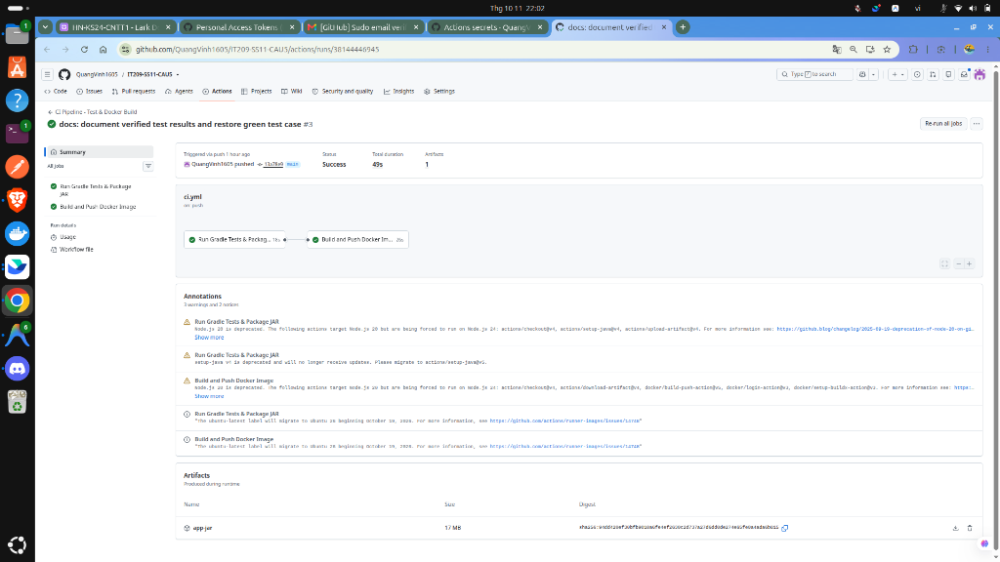

# Bài Tập DevOps - Session 11: Bài 5 (EX5)
## Nối Job tự động Build & Push Docker Image sau khi Test Gradle xanh

- **Học viên:** Nguyễn Quang Vinh (Vinh Nguyen)
- **Tài khoản GitHub:** `QuangVinh1605`
- **Môn học:** DevOps (IT209) - Session 11
- **Kho lưu trữ GitHub:** [QuangVinh1605/IT209-SS11-CAU5](https://github.com/QuangVinh1605/IT209-SS11-CAU5)
- **Đường dẫn bài nộp:** [`homework/session_11/ex5/`](homework/session_11/ex5/README.md)

---

## 1. Tóm Tắt Đề Bài & Yêu Cầu
- Tách luồng CI thành 2 Job riêng biệt:
  - **Job `test`:** chạy Gradle test & đóng gói JAR.
  - **Job `docker-build`:** đóng gói Docker Image đẩy lên `ghcr.io`.
- Ràng buộc thứ tự thực thi bằng từ khóa `needs: test` để chỉ đóng gói Docker Image khi bài test Gradle thành công.
- Kiểm tra biểu đồ DAG trên tab Actions (xuất hiện mũi tên nối từ `test` sang `docker-build`).
- Kiểm tra cơ chế fail-safe: khi JUnit Test hỏng, job `docker-build` tự động chuyển sang trạng thái `Skipped`.

---

## 2. Kịch Bản GitHub Actions (`.github/workflows/ci.yml`)

```yaml
name: CI Pipeline - Test & Docker Build

on:
  push:
    branches:
      - main
      - master
  pull_request:
    branches:
      - main
      - master
  workflow_dispatch:

jobs:
  test:
    name: Run Gradle Tests & Package JAR
    runs-on: ubuntu-latest
    steps:
      - name: Checkout mã nguồn
        uses: actions/checkout@v4

      - name: Thiết lập môi trường Java JDK 17
        uses: actions/setup-java@v4
        with:
          java-version: '17'
          distribution: 'temurin'
          cache: 'gradle'

      - name: Phân quyền thực thi cho Gradle Wrapper
        run: chmod +x gradlew

      - name: Chạy JUnit Tests & Đóng gói JAR
        run: ./gradlew test bootJar

      - name: Lưu trữ tệp JAR (Upload Artifact)
        uses: actions/upload-artifact@v4
        with:
          name: app-jar
          path: build/libs/app.jar
          retention-days: 1

  docker-build:
    name: Build and Push Docker Image
    needs: test # Chỉ chạy khi job test hoàn thành màu xanh
    runs-on: ubuntu-latest
    permissions:
      contents: read
      packages: write
    steps:
      - name: Checkout mã nguồn
        uses: actions/checkout@v4

      - name: Tải tệp JAR từ Job test (Download Artifact)
        uses: actions/download-artifact@v4
        with:
          name: app-jar
          path: build/libs

      - name: Chuyển đổi tên repository sang chữ thường
        run: |
          echo "IMAGE_NAME=ghcr.io/$(echo '${{ github.repository }}' | tr '[:upper:]' '[:lower:]')" >> $GITHUB_ENV

      - name: Đăng nhập vào GitHub Container Registry
        uses: docker/login-action@v3
        with:
          registry: ghcr.io
          username: ${{ github.actor }}
          password: ${{ secrets.REGISTRY_TOKEN || secrets.GITHUB_TOKEN }}

      - name: Thiết lập Docker Buildx
        uses: docker/setup-buildx-action@v3

      - name: Đóng gói và đẩy Docker Image lên GHCR
        uses: docker/build-push-action@v5
        with:
          context: .
          file: ./Dockerfile
          push: true
          tags: ${{ env.IMAGE_NAME }}:latest
```

---

## 3. Cấu Trúc Thư Mục
```text
.
├── .github/
│   └── workflows/
│       └── ci.yml                                       # Kịch bản CI với 2 jobs nối bằng needs: test
├── .gitignore
├── Dockerfile                                           # Dockerfile tối ưu JRE 17 Alpine
├── README.md                                            # Báo cáo tổng quan root
├── build.gradle                                         # Cấu hình Spring Boot 3.2 & JUnit 5
├── commands.sh                                          # Script tự động hóa kiểm tra
├── gradle/                                              # Gradle wrapper
├── gradlew
├── gradlew.bat
├── homework/
│   └── session_11/
│       └── ex5/
│           ├── ci.yml                                   # Kịch bản nộp bài
│           └── README.md                                # Báo cáo chi tiết Bài 5
├── settings.gradle
└── src/
    ├── main/java/com/example/demo/
    │   ├── DemoApplication.java
    │   └── controller/HelloController.java
    └── test/java/com/example/demo/
        └── DemoApplicationTests.java                    # Bộ kiểm thử JUnit 5
```

---

## 4. Minh Chứng Thực Hiện
- **Ảnh biểu đồ Workflow 2 Jobs kết nối thành công qua `needs: test`:**
  

