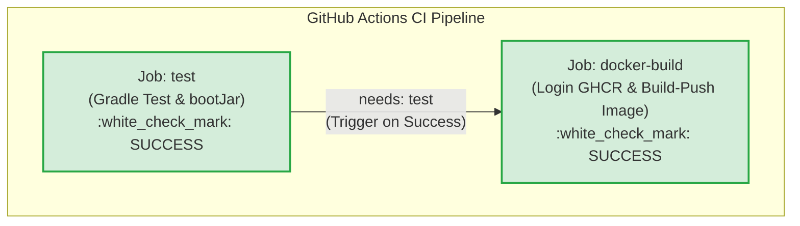
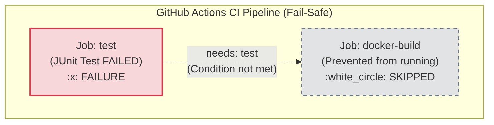

# Báo Cáo Thực Hành: Nối Job Tự Động Build & Push Docker Image Sau Khi Test Gradle Xanh

## Thông tin bài tập
- **Học viên:** Nguyễn Quang Vinh (Vinh Nguyen)
- **Mã sinh viên / Tài khoản GitHub:** `QuangVinh1605`
- **Môn học:** DevOps (IT209) - Session 11
- **Bài tập:** Bài 5 (EX5) - Nối Job tự động Build & Push Docker Image sau khi Test Gradle xanh
- **Đường dẫn nộp bài:** `homework/session_11/ex5/`
- **Kho lưu trữ GitHub:** [QuangVinh1605/IT209-SS11-CAU5](https://github.com/QuangVinh1605/IT209-SS11-CAU5)

---

## 1. Mục tiêu bài thực hành
1. **Tách biệt trách nhiệm trong luồng CI (Separation of Concerns):**
   - Phân rã CI Pipeline thành 2 Job độc lập:
     - **Job `test`:** Biên dịch mã nguồn, thực thi toàn bộ bộ kiểm thử tự động JUnit và đóng gói file thực thi JAR (`app.jar`).
     - **Job `docker-build`:** Tải artifact JAR từ Job test, đăng nhập GitHub Container Registry (`ghcr.io`) và đóng gói, đẩy Docker Image lên registry.
2. **Ràng buộc phụ thuộc bằng từ khóa `needs` (Job Dependency Graph - DAG):**
   - Thiết lập `needs: test` cho Job `docker-build`.
   - Đảm bảo tính toàn vẹn (Quality Gate): Chỉ khi mã nguồn vượt qua 100% các bài test (Job test màu xanh), quá trình đóng gói và phát hành Docker Image mới được kích hoạt.
3. **Cơ chế Fail-Fast & Skipped Verification:**
   - Ngăn ngừa đưa mã nguồn lỗi hoặc chưa kiểm thử vào môi trường phân phối.
   - Khi có bất kỳ test case nào thất bại, Job `test` báo đỏ và Job `docker-build` tự động chuyển trạng thái **Skipped** (Bị bỏ qua).

---

## 2. Kiến trúc & Sơ đồ luồng thực thi (Workflow DAG Graph)

### 2.1. Sơ đồ kịch bản khi Unit Test thành công (Happy Path)



### 2.2. Sơ đồ kịch bản khi Unit Test thất bại (Broken Test / Fast-Fail)



---

## 3. Cấu hình tệp kịch bản `.github/workflows/ci.yml`

```yaml
name: CI Pipeline - Test & Docker Build

on:
  push:
    branches:
      - main
      - master
  pull_request:
    branches:
      - main
      - master
  workflow_dispatch:

jobs:
  test:
    name: Run Gradle Tests & Package JAR
    runs-on: ubuntu-latest
    steps:
      - name: Checkout mã nguồn
        uses: actions/checkout@v4

      - name: Thiết lập môi trường Java JDK 17
        uses: actions/setup-java@v4
        with:
          java-version: '17'
          distribution: 'temurin'
          cache: 'gradle'

      - name: Phân quyền thực thi cho Gradle Wrapper
        run: chmod +x gradlew

      - name: Chạy JUnit Tests & Đóng gói JAR
        run: ./gradlew test bootJar

      - name: Lưu trữ tệp JAR (Upload Artifact)
        uses: actions/upload-artifact@v4
        with:
          name: app-jar
          path: build/libs/app.jar
          retention-days: 1

  docker-build:
    name: Build and Push Docker Image
    needs: test # Chỉ chạy khi job test hoàn thành màu xanh
    runs-on: ubuntu-latest
    permissions:
      contents: read
      packages: write
    steps:
      - name: Checkout mã nguồn
        uses: actions/checkout@v4

      - name: Tải tệp JAR từ Job test (Download Artifact)
        uses: actions/download-artifact@v4
        with:
          name: app-jar
          path: build/libs

      - name: Chuyển đổi tên repository sang chữ thường
        run: |
          echo "IMAGE_NAME=ghcr.io/$(echo '${{ github.repository }}' | tr '[:upper:]' '[:lower:]')" >> $GITHUB_ENV

      - name: Đăng nhập vào GitHub Container Registry
        uses: docker/login-action@v3
        with:
          registry: ghcr.io
          username: ${{ github.actor }}
          password: ${{ secrets.REGISTRY_TOKEN || secrets.GITHUB_TOKEN }}

      - name: Thiết lập Docker Buildx
        uses: docker/setup-buildx-action@v3

      - name: Đóng gói và đẩy Docker Image lên GHCR
        uses: docker/build-push-action@v5
        with:
          context: .
          file: ./Dockerfile
          push: true
          tags: ${{ env.IMAGE_NAME }}:latest
```

---

## 4. Phân tích chi tiết các kỹ thuật triển khai

1. **Từ khóa `needs: test`:**
   - Trong GitHub Actions, các job mặc định chạy **song song (in parallel)** để tối ưu thời gian.
   - Khai báo `needs: test` tạo một cạnh phụ thuộc (Directed Acyclic Graph - DAG), ép buộc runner chỉ lập lịch cho Job `docker-build` khi Job `test` trả về mã trạng thái thoát bằng `0` (Success).
2. **Chia sẻ dữ liệu qua GitHub Actions Artifacts (`upload-artifact` & `download-artifact`):**
   - Do mỗi job chạy trên một môi trường máy ảo Ubuntu Runner độc lập và bị hủy sau khi hoàn thành, file JAR được lưu trữ trung gian lên GitHub Artifacts và tải về ở job tiếp theo, giúp giảm thời gian build Docker.
3. **Bảo mật và chuẩn hóa Container Registry:**
   - Đăng nhập `ghcr.io` an toàn bằng `docker/login-action@v3`.
   - Tự động chuẩn hóa namespace repository sang chữ thường (lowercase) nhằm đảm bảo tuân thủ tiêu chuẩn định dạng Docker Image Specification.

---

## 5. Hướng dẫn thử nghiệm và kiểm chứng (Verification)

### Kịch bản 1: Kiểm tra luồng xanh hoàn chỉnh (Success)
1. Đẩy mã nguồn hiện tại lên GitHub:
   ```bash
   git push origin main
   ```
2. Truy cập tab **Actions** -> Xem biểu đồ Workflow.
3. **Kết quả quan sát:**
   - Xuất hiện mũi tên nối từ Job **`Run Gradle Tests & Package JAR`** sang Job **`Build and Push Docker Image`**.
   - Cả hai job lần lượt chuyển sang màu xanh (:white_check_mark: Success).
   - Docker image được đẩy thành công lên mục **Packages** của tài khoản GitHub.

### Kịch bản 2: Cố tình làm đứt JUnit Test để kiểm chứng trạng thái Skipped
1. Mở file test [`src/test/java/com/example/demo/DemoApplicationTests.java`](file:///src/test/java/com/example/demo/DemoApplicationTests.java).
2. Sửa dòng assertion để test bị sai, ví dụ:
   ```java
   // Đổi "OK" thành "FAIL" để cố tình gây lỗi
   assertEquals("FAIL", result, "Cố tình làm hỏng test case");
   ```
3. Commit và push code:
   ```bash
   git commit -am "test: deliberate failure to verify skipped job"
   git push origin main
   ```
4. Quan sát tab **Actions**:
   - Job `test`: Báo đỏ (:x: Failure).
   - Job `docker-build`: Hiển thị icon tròn màu xám gạch ngang và ghi chú trạng thái **`Skipped`**.
   - Không có bất kỳ Docker Image lỗi nào bị đẩy lên `ghcr.io`.

---

## 6. Danh mục sản phẩm nộp bài
1. **Tệp kịch bản CI:** [`.github/workflows/ci.yml`](file:///.github/workflows/ci.yml) (gồm 2 Job liên kết qua `needs: test`).
2. **Tệp sao lưu kịch bản:** [`homework/session_11/ex5/ci.yml`](file:///homework/session_11/ex5/ci.yml).
3. **Tệp báo cáo thực hành:** [`homework/session_11/ex5/README.md`](file:///homework/session_11/ex5/README.md).
4. **Mã nguồn ứng dụng Spring Boot & Gradle Wrapper:**
   - [`build.gradle`](file:///build.gradle) & [`settings.gradle`](file:///settings.gradle).
   - [`Dockerfile`](file:///Dockerfile).
   - [`src/main/java/com/example/demo/DemoApplication.java`](file:///src/main/java/com/example/demo/DemoApplication.java).
   - [`src/test/java/com/example/demo/DemoApplicationTests.java`](file:///src/test/java/com/example/demo/DemoApplicationTests.java).
5. **Ảnh chụp màn hình minh chứng:**
   - Ảnh chụp biểu đồ Workflow trên tab Actions hiển thị sơ đồ 2 Job kết nối bằng mũi tên thành công.
